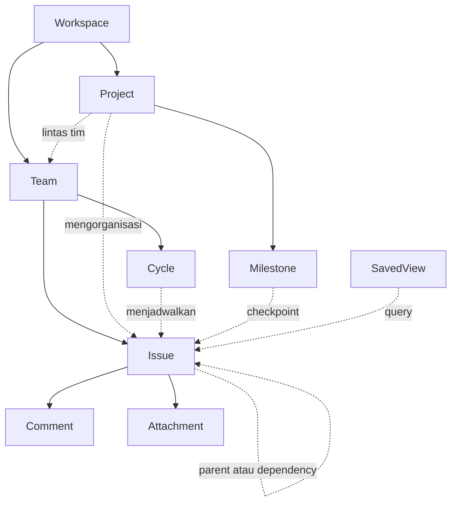

AKOM — Audit produk dan model domain
===================================

Tanggal: 23 Oktober 2026. Baseline: commit `5aecbe52a`.

Audit lanjutan yang menjadi dokumen kerja berkala: [UI dan kesiapan backend](docs/BACKEND_READINESS_AUDIT.md). Dokumen tersebut menyimpan ID temuan, keputusan terbuka, kontrak API usulan, acceptance criteria, dan evidence setiap revisi. Audit produk ini dipertahankan sebagai baseline model domain.

Lingkup: aplikasi AKOM dalam `akom-ui`, yang dipublikasikan sebagai static assets melalui Wrangler. Backend Plane di bagian lain repository bukan bukti bahwa AKOM sudah terhubung ke backend tersebut. Audit ini memeriksa kode, kontrak data, dan alur produk; bukan pengujian penetrasi atau pengujian ulang semua layar.

**Penilaian**

AKOM sudah memiliki prototype alur issue/project yang bisa dipakai untuk validasi pengguna. Untuk sistem pengelolaan kerja tim sehari-hari, fondasi kolaborasi, definisi penyelesaian, dan jejak perubahan belum lengkap. Kelengkapan dinilai berdasarkan siklus menerima pekerjaan → merencanakan → mengerjakan → meninjau → menyelesaikan → melaporkan.

**1. Sasaran dan aktor**

Sasaran MVP yang disarankan: pengelolaan pekerjaan lintas fungsi untuk tim product, engineering, design, dan operasional. Template Brandcom dan Business menunjukkan ambisi lintas fungsi, tetapi template pipeline belum membuktikan adanya sistem approval atau CRM.

| Aktor produk | Kebutuhan utama | Pembeda dari hak akses |
|---|---|---|
| Kontributor | Mengetahui pekerjaan, prioritas, deadline, dan hambatan | Jabatan bukan permission |
| Team lead | Memilah backlog, menentukan kapasitas, mengelola cycle | Kewenangan perlu dikaitkan ke membership |
| Project lead | Mengkoordinasikan tim, milestone, target, dan update | Lead adalah hubungan ke project |
| Requester/stakeholder | Mengajukan permintaan dan mengikuti hasil | Bisa diberi akses terbatas |
| Kolaborator eksternal | Mengerjakan atau memberi masukan pada issue tertentu | Akses harus punya scope dan masa berlaku yang jelas |
| Workspace administrator | Mengelola anggota, tim, dan kebijakan | Peran otorisasi tersendiri |

Saat ini Member.role berisi jabatan, sedangkan akses memakai map membership dan assignee. Belum ada model role/permission produksi.

**2. Use case dan tingkat kelengkapan**

| Alur | Yang tersedia | Yang membatasi kelengkapan |
|---|---|---|
| Menyiapkan ruang kerja | Membuat workspace/team, join/leave team, memilih persona demo | Identitas nyata, invitation, role, dan authorization server |
| Menerima pekerjaan | Triage new/accepted/declined | Jalur submit request belum tersambung; Create issue tidak menetapkan triageState |
| Merencanakan project | Project lintas tim, lead, target date, milestone, stage | Definisi scope, project membership, aturan selesai, archive |
| Menjadwalkan eksekusi | Cycle per team, validasi tanggal/overlap, assignment issue | Close cycle dan keputusan atas pekerjaan tersisa |
| Mengerjakan issue | Status, priority, assignee, due date, rich description, sub-issue | Persistence bersama, concurrency, timestamp, lifecycle archive/delete/restore |
| Mengatasi hambatan | Relasi blockedBy dan tampilan blocking | Pencegahan dependency cycle lebih dari dua issue dan kebijakan penyelesaian saat masih blocked |
| Berkolaborasi | Komentar, mention berbasis teks, attachment link | Notifikasi mention, edit/delete/history komentar, upload/download file nyata |
| Menemukan pekerjaan | Home, My issues, list/board, search, filter, saved view | Owner/visibility view, scope filter yang lebih lengkap, semantik sort berbasis timestamp |
| Memantau progres | Progress project/cycle/milestone, project update | Satu definisi completion, histori throughput/lead time, overdue dan aging |
| Berbagi dengan eksternal | Pembatasan UI berdasarkan assignee dan workspace | Grant akses terpisah dari assignment, revoke, permission pada API |
| Merencanakan strategi | Navigasi Initiatives | Isi halaman masih placeholder |

Contoh use case nyata untuk validasi:

1. Product: request masuk → triage → issue/project → cycle → review → selesai → update stakeholder.
2. Marketing: brief → produksi aset → review → approval → publikasi. Approval memerlukan keputusan/approver bila ingin dijadikan aturan wajib; label atau stage saja belum menjamin persetujuan.
3. Operations: permintaan partner → penanggung jawab → koordinasi lintas tim → checkpoint → selesai. Objek perusahaan, kontak, deal value, dan forecast menjadi kebutuhan terpisah bila sasaran diperluas ke CRM.

**3. Taksonomi: dimensi yang perlu dibedakan**

| Dimensi | Contoh | Makna |
|---|---|---|
| Batas kolaborasi | Workspace | Batas data dan akses |
| Kepemilikan kerja | Team | Tim penanggung jawab issue dan cycle |
| Outcome/scope | Project | Kumpulan kerja lintas tim untuk hasil tertentu |
| Unit kerja | Issue; sub-issue lewat parentId | Pekerjaan yang dapat ditugaskan dan diselesaikan |
| Waktu pelaksanaan | Cycle | Jendela kerja team; satu project bisa melintasi beberapa cycle |
| Checkpoint | Milestone | Target pencapaian dalam project |
| Status eksekusi | Backlog, Todo, In Progress, In Review, Done, Canceled | Keadaan pekerjaan |
| Tahap proses project | Brief, Production, Approval, Published | Posisi dalam proses bisnis project |
| Keputusan intake | New, Accepted, Declined | Hasil penyaringan permintaan |
| Kondisi pekerjaan | Blocked, overdue, unassigned | Sebagian dapat dihitung dari relasi dan tanggal |
| Urgensi | Priority | Urutan perhatian, bukan status |
| Jenis pekerjaan | Task, Bug, Request — usulan | Bedakan dari label bidang/topik |
| Klasifikasi fleksibel | Design, Analytics, Channel, Area | Label dengan scope workspace/team yang jelas |
| Kesehatan project | On track, At risk, Off track | Penilaian risiko, terpisah dari lifecycle project |

Home, Inbox, Triage, My issues, dan All issues merupakan layar/proyeksi. List dan Board merupakan cara menampilkan data. Custom view menyimpan query dan presentasinya, bukan salinan issue.

**4. Objek dan relasi**

| Objek | Implementasi saat ini | Kontrak model yang disarankan |
|---|---|---|
| User/Member | Anggota statis dan persona | User sebagai identitas; membership sebagai hubungan dan permission |
| Workspace | Record tersimpan lokal | Satu batas tenancy untuk data dan akses |
| WorkspaceMembership / TeamMembership | Map user ke array ID | Hubungan dengan role, status invitation, joinedAt/revokedAt |
| IssueAccessGrant | Akses eksternal diturunkan dari assignee | Hubungan user ke issue dengan permission dan revoke tersendiri |
| Team | Workspace, prefix, nama, warna | Memiliki issue dan cycle; keanggotaan bukan satu field pada User |
| Project / ProjectTeam | team dan teamIds bersamaan | Relasi banyak team ke banyak project; pilih satu sumber kebenaran |
| Issue | Record utama | ID internal stabil, display identifier, owning team, lifecycle timestamps |
| Issue parent / dependency | parentId dan blockedBy | Sub-issue tetap Issue; validasi graph dependency |
| Workflow / Status / ProjectStage | Enum status global dan stage per project | Pisahkan dimensinya dan tetapkan completion contract |
| Cycle | Record periode per team | Aturan assignment, close, carry-over dan histori |
| Milestone | Record di bawah project | Hanya menerima issue pada project yang sesuai; aturan selesai eksplisit |
| Label / IssueLabel | Array string di dalam Issue | Identitas label, nama, scope; rename tidak mengganti identitas |
| Comment | Array by/body/time di dalam Issue | ID, authorId, createdAt, editedAt; mention menyimpan userId |
| Attachment | Link atau nama/ukuran file | File tersimpan, hak akses, upload state, metadata dan penghapusan |
| ProjectUpdate | Record lokal per project | Penulis, health, timestamp, isi dan histori yang bisa dirujuk |
| SavedView | Workspace, nama, filter, sort, layout | Owner dan visibility; definisi query tersimpan |
| DomainEvent | Belum ada log terpusat | Fakta perubahan yang persisten, bertimestamp, dan terkait actor |
| Notification | Feed demo dan read state dalam memori | Turunan event untuk penerima tertentu; read state per user |
| Initiative — lanjutan | Placeholder | Outcome strategis yang mengelompokkan beberapa project |

Relasi inti yang disarankan:



Aturan integritas MVP:

- Issue dimiliki satu team di satu workspace; project bersifat opsional menurut keputusan produk yang perlu disahkan.
- Project, milestone, team, dan cycle yang dihubungkan harus kompatibel workspace-nya.
- Milestone harus berasal dari project issue; cycle harus berasal dari owning team issue.
- Saat issue dipindah team/project, relasi yang tidak valid harus ditangani sebagai satu operasi.
- Dependency graph tidak boleh membentuk siklus, termasuk A → B → C → A.
- Archive dan delete memiliki arti berbeda; item yang masih dirujuk memerlukan aturan pemulihan atau penanganan relasi.
- Assignee adalah pemilik pekerjaan. Akses eksternal merupakan grant tersendiri, sehingga mengganti assignee tidak secara implisit menentukan seluruh kebijakan berbagi.

**5. Temuan prioritas dari kode saat ini**

1. **Fondasi kolaborasi belum tersedia pada AKOM.** State utama disimpan di localStorage. Deployment mengirim static assets. Tidak ada API/backend AKOM yang digunakan untuk state ini. Data dua browser tidak otomatis menjadi satu sumber kebenaran. Nomor issue dihitung dari maksimum array lokal, sehingga belum merupakan alokasi ID yang aman untuk concurrent creation.

2. **Completion contract belum seragam.** Issue.status dan Issue.workflowStage sengaja merupakan dimensi berbeda. Perubahan status tidak otomatis mengubah stage. Progress cycle memakai status Done; progress project memakai category completed pada stage; milestone memakai status Done. Issue dengan status Done tetapi stage kategori started bisa dihitung selesai pada cycle dan belum selesai pada project. Project juga memasukkan issue canceled dalam denominator, sementara cycle mengecualikannya. Dua dimensi dapat dipertahankan, tetapi completion dan rumus progres harus didefinisikan, dilabeli, dan konsisten.

3. **Event/history belum menjadi model data.** modify() hanya menimpa record. Feed memuat contoh statis dan penambahan saat create issue; sebagian besar perubahan status/assignee/due date tidak menghasilkan event historis. Timestamp seperti Today/Just now/Oct 17 adalah teks presentasi, sehingga tidak cukup untuk audit, SLA, lead time, atau pengurutan waktu yang andal.

4. **Assignment dan akses masih tercampur.** Hak baca eksternal diturunkan dari assignee. Itu berguna untuk prototype, tetapi reviewer/stakeholder belum mempunyai grant terpisah. Pembatasan di UI belum menggantikan authorization pada server.

5. **Klasifikasi dan kepemilikan memiliki sumber ganda.** Member menyimpan string workspace/team, map membership menyimpan hubungan lain, dan Project memiliki team serta teamIds. Label hanya string. SavedView tidak memiliki owner atau visibility. Tetapkan sumber kebenaran sebelum memindahkan model ke database.

6. **Intake, close, dan lifecycle belum menutup seluruh alur.** Triage baru dapat menerima/menolak issue berflag new, tetapi jalur request baru belum ditetapkan. Cycle memiliki fase kalender tanpa proses close/carry-over. Issue belum punya archive/delete/restore sebagai alur produk lengkap.

7. **Kolaborasi dan pelaporan masih parsial.** File attachment menyimpan metadata tanpa isi. Mention memasukkan nama ke teks. Inbox belum menjadi delivery notification persisten. Progress saat ini merupakan snapshot, belum histori hasil kerja atau prediksi kapasitas.

**6. Event yang perlu dimodelkan**

Daftar berikut merupakan rancangan event domain. Keberadaan aksi UI saat ini tidak berarti event tersebut sudah dicatat.

| Domain | Event utama |
|---|---|
| Workspace dan akses | WorkspaceCreated, MemberInvited, MemberJoined, MembershipRoleChanged, AccessGranted, AccessRevoked |
| Team | TeamCreated, TeamMemberJoined, TeamMemberLeft |
| Intake | IssueSubmittedToTriage, TriageAccepted, TriageDeclined |
| Issue | IssueCreated, IssueStatusChanged, IssueAssigneeChanged, IssuePriorityChanged, IssueDueDateChanged, IssueDescriptionUpdated |
| Scope kerja | IssueTeamChanged, IssueProjectChanged, IssueMilestoneChanged, SubIssueLinked |
| Dependency | DependencyAdded, DependencyRemoved |
| Kolaborasi | CommentAdded, CommentEdited, CommentDeleted, UserMentioned, AttachmentAdded, AttachmentRemoved |
| Project | ProjectCreated, ProjectStatusChanged, ProjectTargetDateChanged, IssueProjectStageChanged, ProjectWorkflowConfigured, ProjectUpdatePublished |
| Milestone | MilestoneCreated, MilestoneTargetDateChanged, MilestoneCompleted |
| Cycle | CycleCreated, CycleDatesChanged, IssueAddedToCycle, IssueRemovedFromCycle, CycleClosed, IssueCarriedOver |
| Saved view | ViewCreated, ViewUpdated, ViewDeleted |
| Lifecycle | IssueArchived, IssueRestored, ProjectArchived, ProjectRestored |
| Notifikasi | NotificationCreated, NotificationRead |

Contoh event:

```json
{
  "id": "evt_...",
  "type": "IssueStatusChanged",
  "workspaceId": "product",
  "entityType": "issue",
  "entityId": "issue_uuid",
  "actorId": "raka",
  "occurredAt": "2026-10-23T09:15:00Z",
  "changes": {"status": {"before": "In Review", "after": "Done"}}
}
```

MVP dapat memakai state terkini dan tabel event append-only. Perubahan record dan pencatatan event dilakukan secara atomik. Activity timeline dan notification menjadi konsumen event, dengan aturan penerima serta permission. Tidak semua perubahan harus mengirim notifikasi; contohnya assignment baru dan mention relevan untuk penerima, sedangkan koreksi judul dapat cukup masuk history.

**7. Urutan pengembangan**

1. **P0 — kontrak domain dan fondasi:** tetapkan arti selesai, source of truth kepemilikan/membership, permission matrix, database/API/auth, ID/timestamp, event log dan integritas relasi. Cocokkan pilihan backend dengan bagian Plane yang ingin dipakai kembali; keputusan tersebut belum disahkan dalam audit ini.
2. **P1 — MVP operasional:** intake yang nyata, notifikasi persisten, komentar/file yang lengkap, cycle close/carry-over, archive/restore, shared/private view, bulk action, ekspor data, serta ringkasan overdue/blocked/throughput.
3. **P2 — sesuai kebutuhan pengguna:** timeline/roadmap, estimates/capacity, automations, integrations, initiative/portfolio, dan formal approval. Budget/time tracking atau CRM memerlukan validasi use case tersendiri.

Acceptance MVP: dua pengguna pada dua browser melihat data yang sama; akses yang dicabut ditolak API; perubahan punya actor dan timestamp; issue yang selesai dihitung konsisten; pemindahan scope tidak membuat relasi yatim; request dapat ditelusuri sampai selesai; pekerjaan tersisa pada akhir cycle mempunyai keputusan; pengguna dapat mengekspor data dan memulihkan item yang diarsipkan.

**8. Bukti kode yang diperiksa**

- `src/main.tsx:39–51`: tipe objek utama.
- `src/main.tsx:125`: prioritas stage eksplisit sebelum fallback dari issue status.
- `src/main.tsx:136–148`: saved view dan namespace penyimpanan.
- `src/main.tsx:224–243`: predicate akses dan persistence browser.
- `src/main.tsx:256`: mutasi issue tanpa pencatatan domain event.
- `src/main.tsx:284–295`: pembuatan sub-issue/issue, alokasi identifier, feed create.
- `src/main.tsx:383–386`: triage, custom view, dan placeholder initiative.
- `src/main.tsx:488`: progress project berdasarkan project workflow.
- `src/main.tsx:502–530`: bentuk dan persistence project update.
- `src/main.tsx:565–573`: perpindahan stage project yang terpisah dari status issue.
- `src/main.tsx:647–652`: dependency, attachment metadata, komentar.
- `src/cycles.ts:24–46`: validasi cycle, kompatibilitas team/workspace, dan rumus progress.
- `src/home-data.ts`: proyeksi Home dari issue/project/activity.
- `wrangler.jsonc`: distribusi static assets untuk preview AKOM.

Batas audit: tidak mengubah aplikasi atau konfigurasi deployment; tidak menjalankan uji concurrency lintas pengguna, recovery/backup, authorization server, atau perangkat fisik. Ketiadaan backend dinilai pada aplikasi AKOM yang diperiksa, bukan seluruh kemampuan upstream Plane. Temuan model di atas berasal dari pembacaan kode saat ini; pilihan model target dan prioritas adalah rekomendasi produk.
